# X-Line Admin Dashboard — User Guide

This guide shows you, step by step, how to manage the projects on the X-Line website. You do not need any technical knowledge.

> 🎬 **Prefer to watch?** Open the video **Admin-Dashboard-Walkthrough.mp4** (same folder as this guide). It shows every step below.

**What you can do in the dashboard**

- Add a new project to the website, with English and Arabic text and pictures
- Edit or remove an existing project
- Choose which sections of a project page are shown
- Keep a project hidden (as a *draft*) until it is ready
- Change the order projects appear in
- Change your own password

---

## 1. Before you start

| You need | Details |
| --- | --- |
| **The address** | `https://your-website/admin` (while testing on the office computer: `http://localhost:4200/admin`) |
| **Login details** | An email and a password. Ask the site administrator if you do not have them. |
| **A browser** | Chrome, Edge, Firefox or Safari. It also works on a phone — the menu is behind the ☰ button. |
| **Your pictures** | JPG, PNG, WebP or AVIF, up to 12 MB each. Wide (landscape) pictures at least 1600 pixels across look best. |

---

## 2. Signing in and out

1. Open the admin address.
2. Type your **email** and **password**, then click **Sign in**.

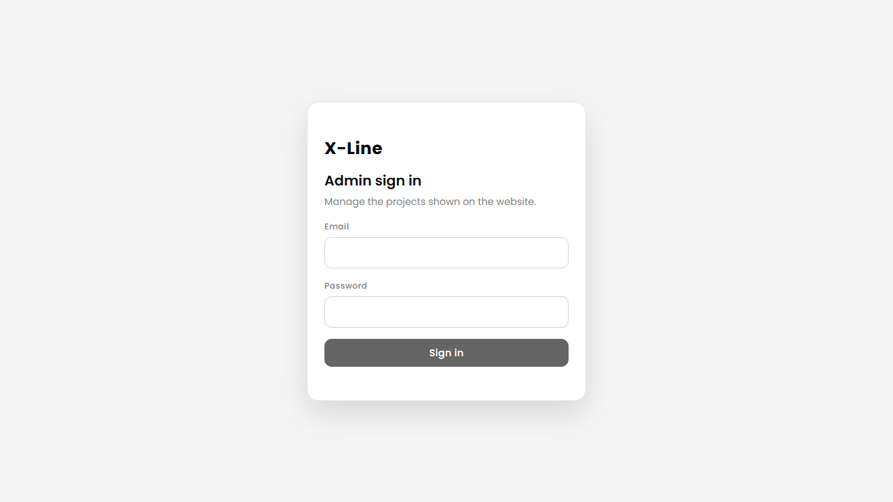

- A wrong password shows *"Incorrect email or password"*. After several wrong tries you must wait a few minutes before trying again.
- To leave, click **Sign out** at the bottom of the left menu. Always sign out on a shared computer.
- If you leave the page open for a long time, the dashboard keeps you signed in for you. If it ever asks you to sign in again, just do so — nothing you saved is lost.

---

## 3. The dashboard

After signing in you see the **Dashboard**.

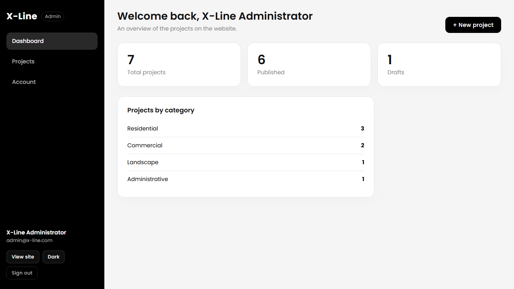

- **Total projects** — everything in the system.
- **Published** — projects visitors can see on the website.
- **Drafts** — projects only you can see.
- **Projects by category** — how many projects are in each category.

The menu on the left has three places: **Dashboard**, **Projects** and **Account**. The buttons at the bottom of the menu: **View site** (opens the public website), **Dark/Light** (changes the colours of the dashboard) and **Sign out**.

---

## 4. Your list of projects

Click **Projects** in the left menu.

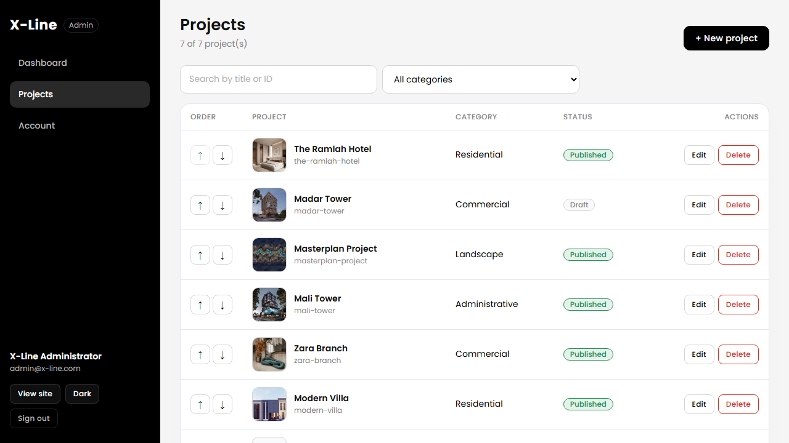

Each row shows the picture, the title, the **ID** (the project's web address), the **category** and the **status**:

- **Published** (green) — visible on the website.
- **Draft** (grey) — hidden from visitors.

**Find a project**

- Type part of a title or ID in the search box.
- Or pick a **category** from the drop-down.

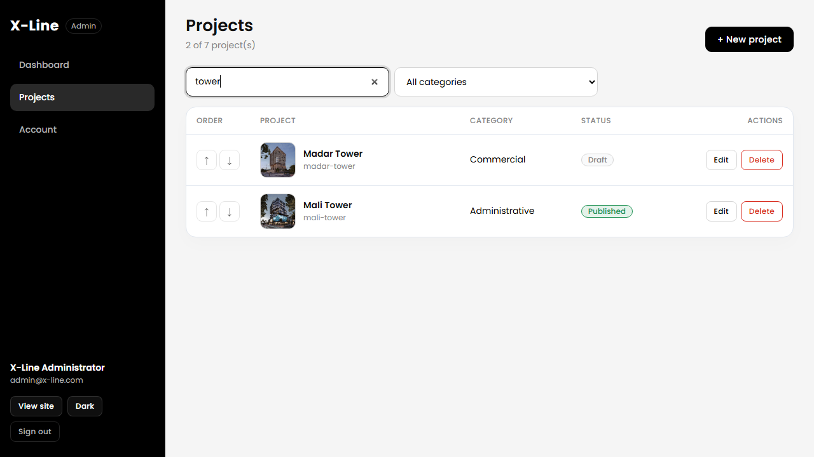

**Change the order**

The **↑ ↓ arrows** move a project up or down. The website shows projects in this order. The arrows work when the search box and the category filter are empty.

---

## 5. Adding a new project

Click **+ New project** (top right of the list).

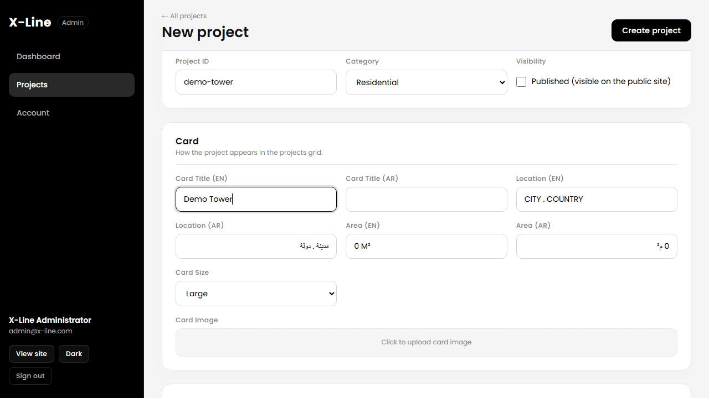

### Step 1 — Title and ID
Type the **English card title** (for example *Demo Tower*). The **Project ID** fills itself in (*demo-tower*). The ID becomes the project's web address, `…/selected-project/demo-tower`.

- You can type your own ID instead. Use only small letters, numbers and hyphens.
- **The ID cannot be changed after the project is created.**

### Step 2 — Category
Choose where the project belongs: Administrative, Commercial, Interior Design, Entertainment, Landscape or Residential.

### Step 3 — Text in English and Arabic
Every text box comes in pairs, **(EN)** and **(AR)**. Fill in both languages so the page looks right whichever language the visitor chooses. Arabic boxes are written right-to-left automatically.

### Step 4 — Card image and hero image
Two pictures are **required** before a project can be published:

| Picture | Where visitors see it |
| --- | --- |
| **Card image** | The small picture in the projects grid and on the home page |
| **Hero image** | The big picture at the top of the project page |

Click the dashed box and choose a file. The picture is uploaded, shrunk to a web-friendly size automatically, and a small preview appears.

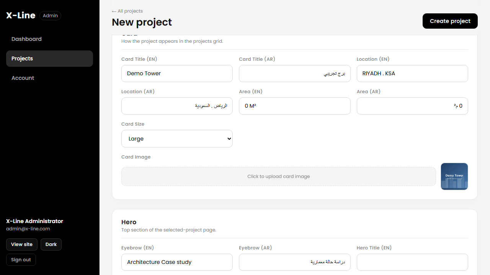

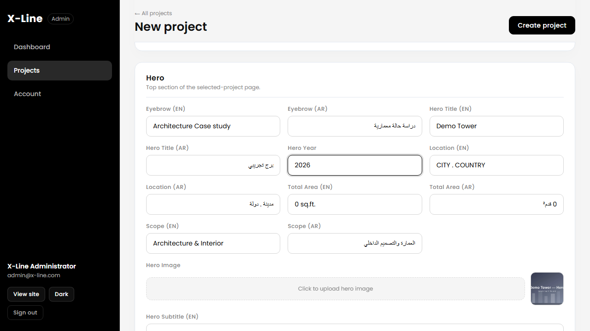

Fill in the hero details too: title, subtitle, year, location, total area and scope.

### Step 5 — Choose the sections to show
Project pages are made of sections. Some are optional. In the **Narrative** and **Media** parts of the form, every section has a tick box called **Show on project page**:

| Section | What it is |
| --- | --- |
| **Challenge** | The problem the project had to solve |
| **Concept** | The idea behind the design |
| **Solution** | How the design answered the challenge |
| **Design Process** | A gallery of plans and process pictures |
| **Visual Journey** | A gallery of finished photographs |
| **Spatial Experience** | One large picture with a short text |

**Untick** a section you do not need and it will not appear on the website. You can tick it again later. A project can show any combination, even none.

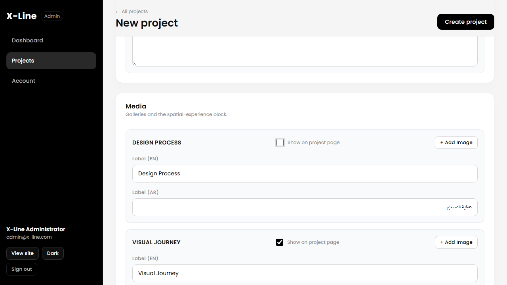

**Galleries** (Design Process and Visual Journey): click **+ Add image** for each picture, then upload it. **Remove** deletes a picture from the list.

### Step 6 — Published or draft
Near the top, under **Identity**, is the **Published** tick box.

- **Ticked** — visitors can see the project as soon as you save.
- **Unticked** — the project is a **draft**, hidden from visitors.

If you tick **Published** but have not added the card and hero images, an orange warning explains what is missing:

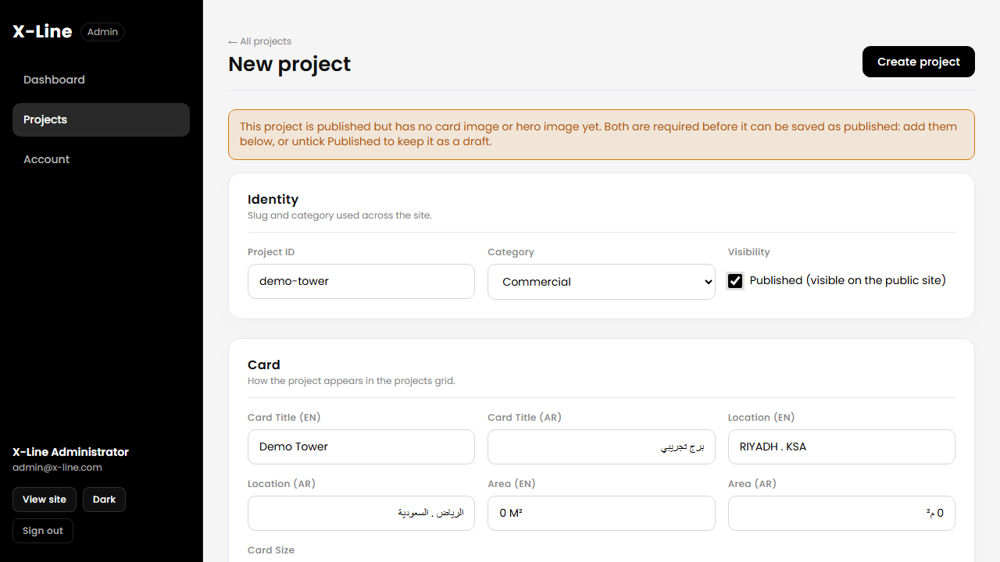

### Step 7 — Save
Click **Create project** (top right). You are taken to the project's edit page and see **"Project saved."**

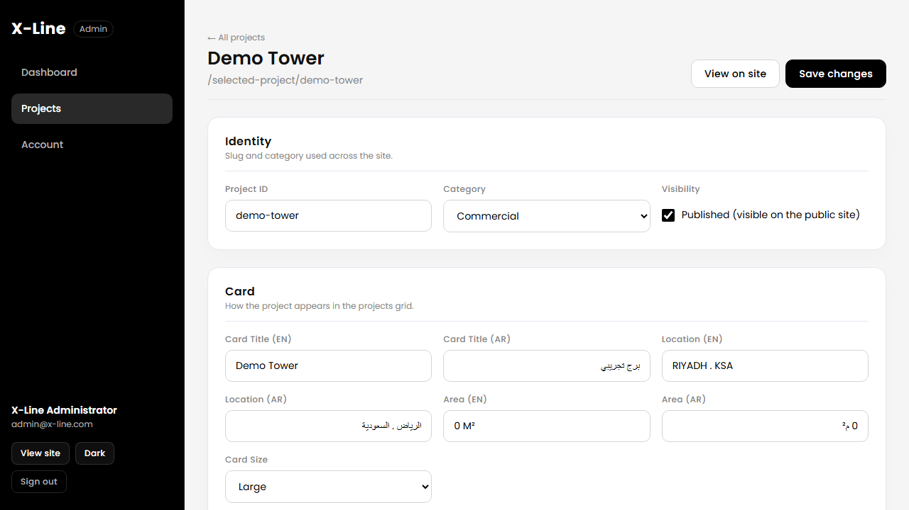

---

## 6. Editing a project

1. Go to **Projects** and click the project's title or **Edit**.
2. Change anything you like.
3. Click **Save changes**.

Good to know:

- If you try to leave the page with changes that are not saved, the dashboard asks you first, so you cannot lose work by accident.
- The ID is locked once a project exists.
- If you replace a picture, the old one is removed from the server automatically.

---

## 7. Seeing the project on the website

On the edit page click **View on site**. The public page opens in a new tab, exactly as a visitor would see it.

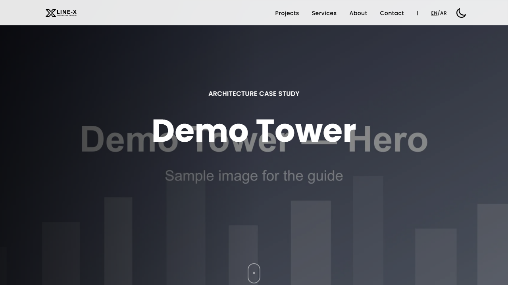

The sections you unticked are not there.

---

## 8. Hiding a project (draft)

To take a project offline without deleting it:

1. Open the project and **untick Published**.
2. Click **Save changes**.

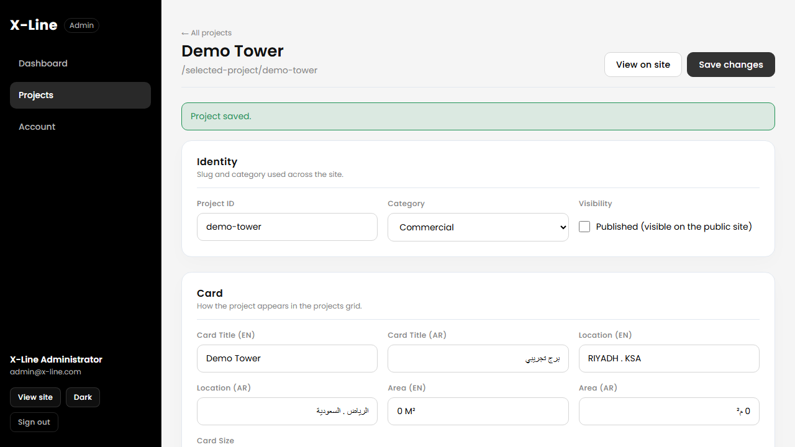

The project is now a **draft**. Visitors get a "page not found" message if they try its address. You can still preview it: click **View on site** while you are signed in and you will see an orange **"Draft preview"** bar on top.

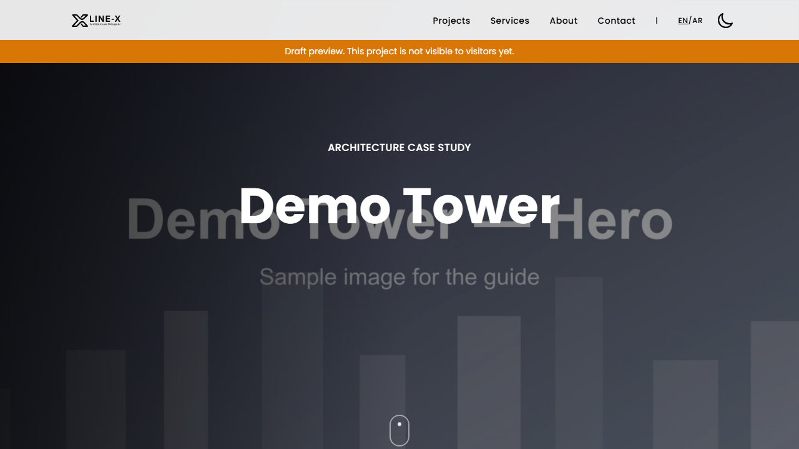

To publish again, tick **Published** and save.

---

## 9. Deleting a project

1. In the **Projects** list, find the project (use the search box).
2. Click **Delete**.
3. A box asks you to confirm. Click **Delete** again, or **Cancel** to keep it.

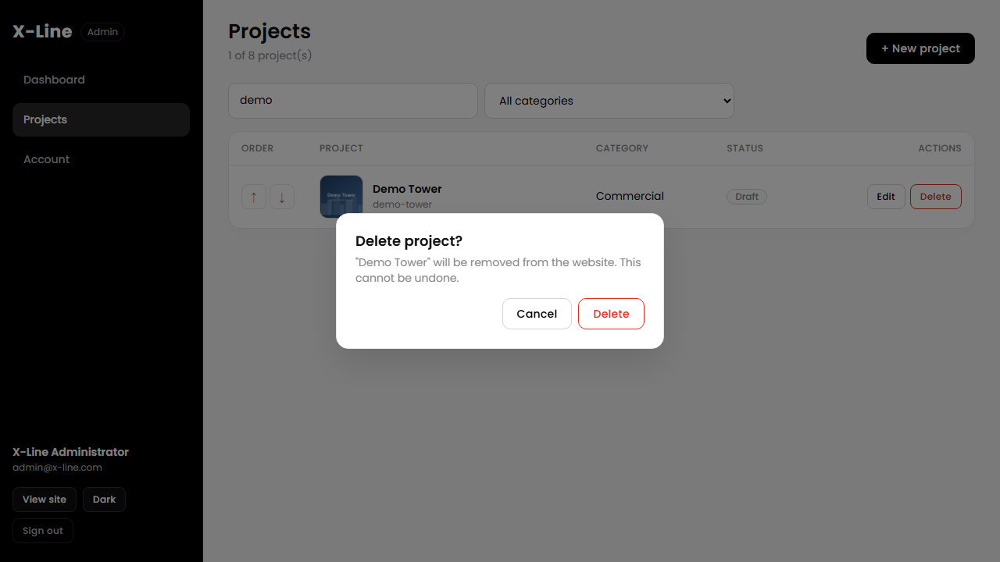

> ⚠️ **Deleting cannot be undone.** The project and its pictures are removed for good. If you only want it off the website, make it a **draft** instead (section 8).

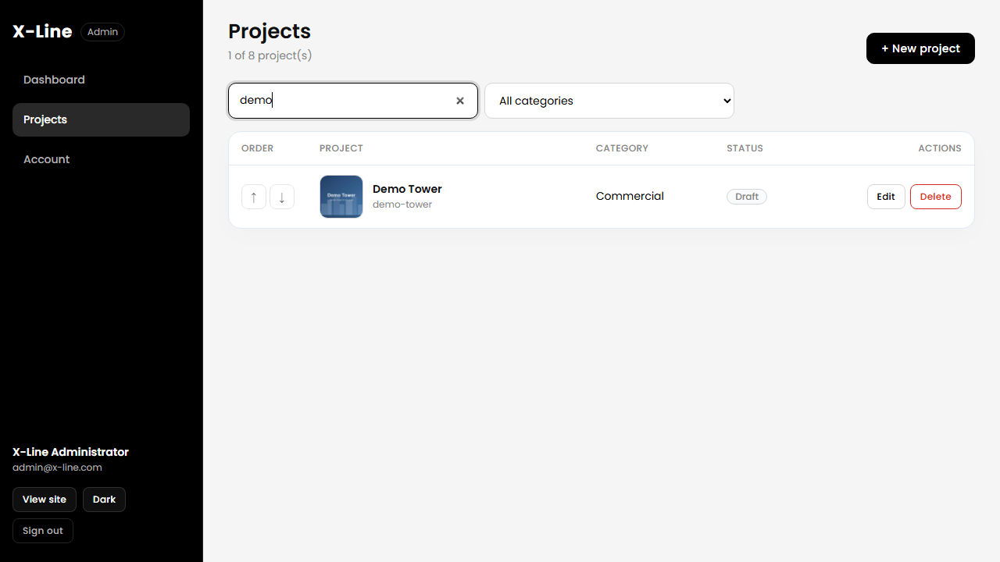

---

## 10. Your account and password

Click **Account** in the menu. You see your name, email and role.

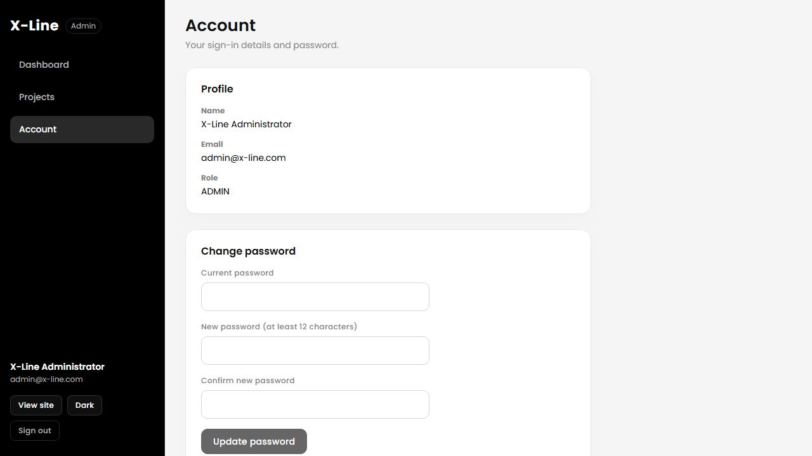

To change your password:

1. Type your **current password**.
2. Type a **new password** — at least **12 characters**. A short phrase with numbers works well.
3. Type it again to confirm, then click **Update password**.

---

## 11. Using the dashboard on a phone or tablet

Everything works on a phone. The menu is hidden behind the **☰** button at the top left — tap it to open the menu, tap a page to go there. Uploading photos from the phone's gallery works the same way.

---

## 12. Quick checklist before publishing a project

- [ ] English **and** Arabic titles are filled in
- [ ] The category is correct
- [ ] **Card image** and **hero image** are uploaded
- [ ] Year, location, area and scope are filled in
- [ ] Only the sections you want are ticked **Show on project page**
- [ ] You clicked **Save** and saw "Project saved."
- [ ] You checked it with **View on site**
- [ ] **Published** is ticked (if it should be live)

---

## 13. Problems and answers

| What you see | What it means / what to do |
| --- | --- |
| *"Add a card image before publishing"* / *"Add a hero image before publishing"* | A published project needs both pictures. Upload them, or untick **Published** to save a draft. |
| *"A project with this ID already exists"* | Another project already uses that web address. Change the ID. |
| *"Use lowercase letters, numbers and hyphens only"* | The ID may only contain small English letters, numbers and `-`. |
| *"The file is not a valid image"* | The file is not a real picture. Use JPG, PNG, WebP or AVIF. |
| *"File exceeds the 12MB limit"* | The picture is too big. Make it smaller (most phone photos are fine). |
| *"Cannot reach the server"* | The website's server is not running or you are offline. Try again in a minute, then tell the administrator. |
| *"Too many requests"* / *"Too many sign-in attempts"* | Wait a few minutes and try again. |
| You were sent back to the sign-in page | Your session ended. Sign in again — your saved work is safe. |
| A project is missing from the website | Check that **Published** is ticked and saved. Drafts are hidden. |
| A picture looks too dark or empty at the top of a project | The **hero image** is missing — upload one. |
| You deleted something by mistake | It cannot be restored from the dashboard. Ask the administrator whether a backup exists. |

---

## 14. Words used in this guide

| Word | Meaning |
| --- | --- |
| **Project ID** | The project's web address ending, for example `demo-tower`. Cannot be changed. |
| **Published / Draft** | Visible to visitors / visible only to you |
| **Card** | The small project tile in the grid |
| **Hero** | The big picture and title at the top of a project page |
| **Section** | One block of a project page (Challenge, Concept, …) |
| **EN / AR** | English / Arabic |

---

*Need help?* Contact the site administrator: ______________________
